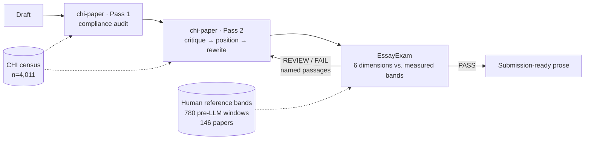
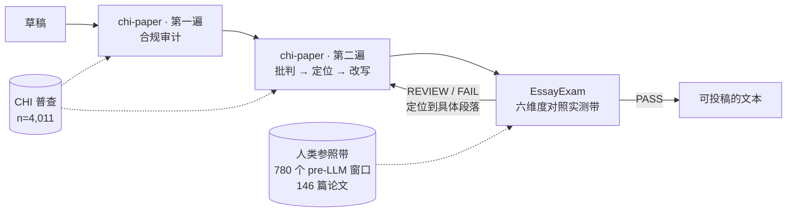

# ClaudeEssaySkill — measured writing guidance for ACM CHI, and a calibrated prose verifier / ClaudeEssaySkill — 用实测数据支撑的 ACM CHI 写作指导，以及一套经过校准的文本验证器

**English**

> Two Claude Code skills that work as a generator/verifier pair for academic manuscripts.
> Everything they assert about "what a normal paper looks like" is measured against a
> **census of 4,011 ACM CHI papers (2024–2026)** and a reference corpus of human-written
> prose — not remembered, not inferred from a model's priors.
>
> The skill source is in a **private repository**; access is by request. This repository is the
> public record of what was built, how it was calibrated, and how well it currently performs.

---

**中文**

> 两个 Claude Code skill，构成学术论文的「生成器 / 验证器」配对。
> 它们对「一篇正常的论文长什么样」的每一处断言，都对照
> **4,011 篇 ACM CHI 论文（2024–2026）的全量普查**与一套人类写作参照语料实测得出，
> 而不是凭记忆、也不是从模型先验里推断出来的。
>
> skill 源码存放在**私有仓库**，需申请获取权限。本仓库是公开记录：做了什么、如何校准、目前表现如何。

---

## The problem this was built for / 这个工具要解决的问题

**English**

Writing advice for a top-tier venue is mostly folklore. "Keep the abstract around 250 words."
"A CHI paper runs about 10,000 words." "You need 60 references." These circulate, they sound
authoritative, and almost nobody has checked them against the actual proceedings.

For a first-time submitter with no CHI-published co-author, that is a real problem: there is no
intuition to fall back on, and no way to tell a reliable rule from a confident guess. So I stopped
taking the numbers on faith and measured them.

The result changed the advice. Two examples, both of which had been wrong in my own drafts:

| Folklore | Measured | Consequence of believing the folklore |
|---|---|---|
| "Abstract ≈ 150–250 words" | **150 words maximum** — stated on CHI's Papers page; census median **149**, 72.5% land in 140–160 | An abstract well over the cap, rejected by the submission form, discovered at the deadline |
| "CHI papers run ~11,300 words" | Official counted band is **5,000–8,000** (avg 7,000–8,000). The 11,300 figure was **raw text before the references heading** — different units | Padding an 8,600-word draft toward the 12,000-word desk-reject threshold |

The second one is the more instructive failure. The number was not invented; it was correctly
measured and then quoted in the wrong units, ~100 lines away from the compliance file that had the
right answer. Precision without unit discipline is just a confident error.

**中文**

顶会写作建议大多是口口相传的经验。「摘要控制在 250 词左右」「CHI 论文大概一万词」「参考文献要 60 条」——
这些说法流传甚广、听上去很权威，却几乎没人真正拿会议论文集核对过。

对一个没有 CHI 发表经历的合著者、第一次投稿的人来说，这是个真问题：没有直觉可依，
也无从分辨哪条是可靠规则、哪条只是自信的猜测。所以我不再照单全收，而是把这些数字实测了一遍。

结果改写了建议本身。下面两例，在我自己的草稿里都曾经是错的：

| 流传的说法 | 实测结果 | 信了会怎样 |
|---|---|---|
| 「摘要约 150–250 词」 | **上限 150 词**——CHI 官方 Papers 页面明文规定；普查中位数 **149**，72.5% 落在 140–160 | 摘要远超上限，投稿系统不收，到截稿日才发现 |
| 「CHI 论文约 11,300 词」 | 官方计数区间是 **5,000–8,000**（平均 7,000–8,000）。11,300 是**参考文献标题之前的原始文本**——单位不同 | 把一份 8,600 词的草稿往 12,000 词的桌拒线上填 |

第二个失误更有教益。那个数字并非编造，它测得没错，只是**被用错了单位**，
而且离那份写着正确答案的合规文件只有约 100 行。没有单位纪律的精确，不过是自信的错误。

## The second problem: detector scores that mean nothing / 第二个问题：没有意义的检测分数

**English**

Every AI-text detector returns a number in [0,1]. None of them tell you what it means. "This
paragraph scored 0.31" is not a probability that you cheated, not a percentage of your text, and not
comparable across tools.

So the verifier does not report raw scores. It reports them **against a measured reference band**:
the same detector, the same window size, run over papers whose arXiv v1 predates ChatGPT's public
release — prose that *cannot* contain generated text.

That measurement produced the single most important number in this project:

> **17.1% of windows from definitively human-written academic papers score above 0.5.**
> 4.5% score above 0.9.

That is the detector's false-positive rate on the exact task people use it for. It means no single
passage score supports any conclusion, and it means every product that shows you a percentage is
showing you something it cannot justify.

**中文**

所有 AI 文本检测器都给你一个 [0,1] 的数，却没有一个告诉你它是什么意思。
「这段得了 0.31」——它不是你作弊的概率，不是文本的 AI 占比，也不能跨工具比较。

所以验证器不报原始分数，而是**对照实测参照带**来报：同一个检测器、同样的窗口大小，
跑在 arXiv v1 早于 ChatGPT 公开发布的论文上——那些文本**不可能**含有生成内容。

这次测量得出了整个项目里最重要的一个数字：

> **确定由人类撰写的学术论文，17.1% 的文本窗口得分高于 0.5。**
> 4.5% 高于 0.9。

这就是该检测器在人们实际使用它的那个任务上的假阳率。它意味着：
**任何单一段落的分数都不足以支撑任何结论**；也意味着每一个给你看「AI 占比百分数」的产品，
展示的都是它无法自证的东西。

## What the instrument sees / 这套仪器看到的东西

**English**

> **Interactive reports:** [human control](gallery/curve-human-control.html) · [machine control](gallery/curve-machine-control.html) — open either file locally for the full per-window curve with quoted passages.

Two controls, run through the identical pipeline. Log scale, because a clean manuscript sits in the
thousandths and a linear axis flattens everything to zero. The green band is where pre-2022
human-written papers fall.

**Human control** — Darwin, *On the Origin of Species* (1859), public domain, written 163 years
before any language model existed:

**Machine control** — an HCI manuscript generated for this purpose, so its provenance is certain:

The separation is total, and it is not carried by the detector alone. All six dimensions fire
independently on the machine control, which is what construct validity looks like:

| | verdict | median window | windows > 0.5 | fingerprint | sentence CV | defensive/1k | vague/1k |
|---|---|---:|---:|---:|---:|---:|---:|
| Darwin 1859 (human) | PASS 9/9 | 0.0074 | 0% | 0.7% | 0.619 | 0.0 | 7.27 |
| LLM-generated | **FAIL 7/9** | 1.0000 | 100% | 16.0% | 0.419 | 6.06 | 19.38 |
| *human reference band* | — | *0.0785* | *17.1%* | *median 0.6%* | *median 0.56* | *0.24* | *3.65* |

Note the honest detail: Darwin's peak window reaches 0.13, and his vague-term rate (7.27/1k) sits
above the modern median. The instrument does not pretend that human writing is clean — it reports
where real human prose actually falls, which is the only way its thresholds mean anything.

**中文**

> **交互式报告：**[人类对照](gallery/curve-human-control.html) · [机器对照](gallery/curve-machine-control.html)——本地打开任一文件即可看到完整的逐窗口曲线与引用段落。

两份对照文本，走完全相同的流程。纵轴取对数——干净的稿子分数在千分位，线性轴会把一切压成零。
绿色带是 2022 年前人类论文所在的区间。

**人类对照**——达尔文《物种起源》（1859，公有领域），写成于任何语言模型出现的 163 年前：

**机器对照**——为本项目生成的一篇 HCI 论文，来源确定无疑：

分离是彻底的，而且**不是靠检测器一个维度撑起来的**。六个维度在机器对照上各自独立触发——
这正是构念效度该有的样子：

| | 判定 | 中位窗口 | >0.5 窗口占比 | 指纹 | 句长 CV | 防御性/千词 | 模糊词/千词 |
|---|---|---:|---:|---:|---:|---:|---:|
| 达尔文 1859（人类） | PASS 9/9 | 0.0074 | 0% | 0.7% | 0.619 | 0.0 | 7.27 |
| LLM 生成 | **FAIL 7/9** | 1.0000 | 100% | 16.0% | 0.419 | 6.06 | 19.38 |
| *人类参照带* | — | *0.0785* | *17.1%* | *中位 0.6%* | *中位 0.56* | *0.24* | *3.65* |

请注意这里诚实的细节：达尔文的峰值窗口达到 0.13，他的模糊词率（7.27/千词）也高于现代中位数。
这套仪器**不假装人类写作是干净的**——它报告真实人类散文实际落在哪里，
这是它的阈值能有意义的唯一途径。

## The two skills / 两个 skill

**English**

**`chi-paper`** — the generator. Venue rules verified per cycle, section-by-section structure,
contribution framing, genre routing (empirical / design-arts / general), figures, citations,
positioning, a three-reader mock review with CHI's real A–ARR–RR–RRX–X recommendations, and the
revise-and-resubmit cycle. Plus three stdlib-only tools: a `.docx` compliance auditor, a
corpus-calibrated stylometric fingerprint, and run-boundary-safe `.docx` surgery.

**`EssayExam`** — the verifier. Six dimensions over a draft: sliding-window machine-likeness with the
full probability curve, stylometric fingerprint, defensive/hedged writing, redundancy and
near-duplicate sentences, semantic precision, and logical flow. Returns a pass/review/fail gate where
every check names its source, plus the self-contained HTML curve shown above. Runs entirely locally —
no text leaves the machine.

They compose: `chi-paper` decides what the paper should say and rewrites it; `EssayExam` measures
whether the rewrite actually improved, and hands failing passages back.

**中文**

**`chi-paper`**——生成器。每个投稿周期重新核验的会议规则、逐节结构、贡献陈述框架、
体裁路由（经验型 / 设计-艺术型 / 通用型）、图表、引用、定位策略、
按 CHI 真实的 A–ARR–RR–RRX–X 推荐档位运行的三读者模拟评审，以及 revise-and-resubmit 流程。
外加三个纯标准库工具：`.docx` 合规审计器、语料校准的文体指纹、跨 run 安全的 `.docx` 外科编辑。

**`EssayExam`**——验证器。对草稿测六个维度：滑窗机器相似度（含完整概率曲线）、文体指纹、
防御性/对冲写作、冗余与近重复句、语义精确度、逻辑衔接。
输出 pass/review/fail 闸门，每一项检查都标注其依据来源，外加上面那张自包含 HTML 曲线图。
**全本地运行——文本不出本机**。

两者可组合：`chi-paper` 决定论文该说什么并改写，`EssayExam` 测量改写是否真的变好，
并把未通过的段落交回去。

## How it was built and tested / 如何构建与检验

**English**

The skills were hardened with a GAN-shaped loop: a white-box **adversary** writes realistic user
requests designed to break the skill, a blind **generator** answers them using only the skill, and two
independent blind **verifiers** score the answers against the census on a fixed five-dimension rubric.
Failures become patches; the next round attacks the patches.

| Round | Scenarios | Mean | Inter-rater gap | Result |
|---|---:|---:|---:|---|
| 1 — baseline | 12 | **85.6** | 2.1 | 1 FAIL (39.0), 2 WEAK |
| 1 — **re-test of the patched scenarios** | 6 | **78.6 → 93.0** | 1.0 | **+14.4**; 6/6 PASS |
| 2 — new, harder set | 12 | **93.6** | 1.2 | 12/12 PASS |

The re-test is the row that carries the argument. Round 2 scoring higher than Round 1 could just mean
Round 2 was easier. Re-running the *same six scenarios* whose material was patched, scored on the same
fixed rubric, cannot be explained that way:

| Scenario | Before | After | What was patched |
|---|---:|---:|---|
| Format audit on a numbered-heading draft | 39.0 | **92.4** | `audit_docx.py` bibliography-heading regex |
| Abstract length | 77.0 | **93.7** | 150-word limit replacing "~150–250" |
| Length advice for an empirical paper | 79.7 | **89.6** | counted-vs-raw word units |
| Reference count | 91.8 | **94.8** | counted-vs-raw word units |
| Title choice | 91.8 | **92.5** | title guidance (new section) |
| Multiple outcomes, three reported | 92.5 | **95.1** | statistical procedure (new section) |

Round 1's findings drove the abstract fix, the word-unit fix, a silent parser bug that inflated
counted word totals by ~1,000 words on a 38-reference paper, missing title guidance, and missing
statistical-procedure guidance. Re-testing those same scenarios against the patched skill is the
check that matters: the patches generalised rather than memorising the cases.

A third and harder round was then generated, aimed squarely at the newest material — the
just-written statistics section, the handoff between the two skills, and genre-routing edges. It is
**not yet scored**, and it has already produced two confirmed defects, both now fixed:

- The new statistics section quoted base rates (3% / 9.5% / 5.5%) that **contradicted another
  section of the same file** (4% / 11% / 7%). Both were correct for their own denominator and neither
  said so — the same units failure as the word-count bug, committed while writing the fix for it.
- `EssayExam`'s fast path skips the three detector checks, and the gate counted only *failing*
  checks — so a document that would fail on machine-likeness alone could report **PASS** with the
  headline dimension silently not run. There is now a distinct `INCOMPLETE` verdict.

Both were found by the adversary, not by review. That is the argument for keeping the loop running.

The protocol, including where the GAN analogy breaks and the anti-degeneracy rules, is in
[`docs/adversarial-protocol.md`](docs/adversarial-protocol.md). The full census audit is in
[`docs/audit-skill-vs-census.md`](docs/audit-skill-vs-census.md).

**中文**

两个 skill 经由一套 GAN 形态的循环打磨：白盒**对抗器**编写真实用户可能提出的、
专门用来击穿 skill 的请求；盲测**生成器**仅凭 skill 作答；
两个互相独立的盲测**验证器**按固定的五维评分表、对照普查数据打分。
失败项转化为补丁，下一轮再攻击这些补丁。

| 轮次 | 场景数 | 均分 | 评分者差距 | 结果 |
|---|---:|---:|---:|---|
| 第一轮 · 基线 | 12 | **85.6** | 2.1 | 1 项 FAIL（39.0）、2 项 WEAK |
| 第一轮 · **被修补场景的复测** | 6 | **78.6 → 93.0** | 1.0 | **+14.4**；6/6 PASS |
| 第二轮 · 全新加难 | 12 | **93.6** | 1.2 | 12/12 PASS |

**真正撑起论证的是复测那一行。** 第二轮分数高于第一轮，也可能只是因为第二轮更简单；
而拿**同样这六个**被修补材料所对应的场景、用同一份固定评分表重跑，就无法这样解释：

| 场景 | 修补前 | 修补后 | 修补了什么 |
|---|---:|---:|---|
| 对带编号标题的稿子跑格式审计 | 39.0 | **92.4** | `audit_docx.py` 的文献标题正则 |
| 摘要长度 | 77.0 | **93.7** | 用 150 词上限取代「约 150–250」 |
| 经验型论文的篇幅建议 | 79.7 | **89.6** | 计数词 vs 原始词的单位区分 |
| 参考文献数量 | 91.8 | **94.8** | 计数词 vs 原始词的单位区分 |
| 标题拟定 | 91.8 | **92.5** | 标题指导（新增小节） |
| 多个结局变量只报三个 | 92.5 | **95.1** | 统计流程（新增小节） |

第一轮的发现直接驱动了：摘要口径修正、词数单位修正、
一个会让 38 条参考文献的论文虚增约 1,000 计数词的静默解析 bug、缺失的标题指导、缺失的统计流程指导。
**真正关键的是拿同一批场景对打完补丁的 skill 复测**——它证明补丁是泛化了，而不是记住了这些题。

随后生成了第三轮、难度更高的一批，专门瞄准最新写下的内容：刚补的统计小节、
两个 skill 之间的交接面、以及体裁路由的边缘情形。该轮**尚未评分**，
但已经产出两个已确认并修复的缺陷：

- 新写的统计小节引用的基线（3% / 9.5% / 5.5%）**与同一文件另一小节的数字相互矛盾**（4% / 11% / 7%）。
  两组数都对，只是分母不同，而两处都没说明——这正是词数单位那个 bug 的同款失误，
  而且是在为它写修复时又犯了一次。
- `EssayExam` 的快速通道会跳过三项检测器检查，而闸门只统计**失败**项——
  于是一份只在机器相似度上不合格的文档，会在**头部维度根本没跑**的情况下报 **PASS**。
  现已新增独立的 `INCOMPLETE` 判定。

这两个都是对抗器找出来的，不是靠人工复查。这就是把这个循环持续跑下去的理由。

完整协议（包括 GAN 类比在哪里失效、以及反退化规则）见
[`docs/adversarial-protocol.md`](docs/adversarial-protocol.md)；
完整普查审计见 [`docs/audit-skill-vs-census.md`](docs/audit-skill-vs-census.md)。

## What is published here / 本仓库公开了什么

**English**

| | |
|---|---|
| [`data/chi_census_2024_2026.json`](data/chi_census_2024_2026.json) | Measurements over all 4,011 CHI main-conference papers 2024–2026: abstract lengths, reference counts, title conventions, author counts, subfield composition, per-year trends |
| [`data/calibration_bands.json`](data/calibration_bands.json) | The human reference distributions — percentiles, means, share-over-threshold, for both strata |
| [`data/lexical_bands.json`](data/lexical_bands.json) | Per-1,000-word rates for the four deterministic prose dimensions, with reliability annotations |
| [`gallery/`](gallery/) | Interactive HTML reports for both control documents |
| [`reports/`](reports/) | Full text reports, and the machine-control source document |
| [`docs/`](docs/) | Census audit, adversarial protocol |

**What is deliberately not published:** the source PDFs and full texts the bands were computed from
(4 GB of copyrighted papers), and any output from unpublished manuscripts under review. The published
data are *measurements*, not the works measured. Every band can be rebuilt from scratch with the
harvest and calibration scripts in the core repository.

**中文**

| | |
|---|---|
| [`data/chi_census_2024_2026.json`](data/chi_census_2024_2026.json) | 对全部 4,011 篇 CHI 主会论文（2024–2026）的测量：摘要长度、参考文献数、标题惯例、作者数、子领域构成、逐年趋势 |
| [`data/calibration_bands.json`](data/calibration_bands.json) | 人类参照分布——两个分层的百分位、均值、超阈占比 |
| [`data/lexical_bands.json`](data/lexical_bands.json) | 四个确定性文本维度的每千词基线，附可靠性标注 |
| [`gallery/`](gallery/) | 两份对照文档的交互式 HTML 报告 |
| [`reports/`](reports/) | 完整文字报告，以及机器对照文档的源文件 |
| [`docs/`](docs/) | 普查审计、对抗协议 |

**刻意不公开的部分**：计算这些参照带所依据的源 PDF 与全文（4 GB 受版权保护的论文），
以及任何在审稿中的未发表稿件的输出。这里公开的是**测量结果**，不是被测量的作品。
所有参照带都可以用核心仓库里的采集与校准脚本从零重建。

## Access / 获取权限

**English**

The skill source lives in a private repository. If you want to use it, open an issue here saying what
you would use it for, and I will add you as a collaborator.

A note on why it is arranged this way: **GitHub has no repository mode that shows content publicly
while gating clones.** Public means anyone can `git clone`; private means nobody can without an
invitation. There is no middle setting, because Git's protocol has to serve every object to render
any file. A public repo with a restrictive licence is a *legal* gate, not a technical one. So the
split is: this repository public, the source private, access by invitation.

**中文**

skill 源码在私有仓库。若你想使用，请在本仓库开一个 issue 说明用途，我会把你加为协作者。

关于为什么这样安排：**GitHub 不存在「内容公开可见、但克隆需批准」的仓库模式**。
public 意味着任何人都能 `git clone`；private 意味着没有邀请谁也看不到。中间档不存在——
因为 Git 协议要渲染任何一个文件，就必须把全部对象发给客户端。
公开仓库配一份限制性许可证只是**法律**上的门槛，不是**技术**上的。
所以拆法是：本仓库公开，源码私有，按邀请授权。

## Honest limits / 诚实的边界

**English**

- **This does not detect AI authorship.** No detector can. The 17.1% false-positive floor is measured
  above. ACM and CHI run no detector step; their requirement is **disclosure**.
- **There is no "AI percentage" of a document.** The number does not exist. Any tool reporting one is
  reporting something it cannot justify.
- **A passing gate certifies prose, not contribution.** Reviewers decide on the contribution, and a
  fluent paper with a thin contribution loses to a rough paper with a strong one.
- **The bands are open-access-skewed.** They come from arXiv versions of published papers, which
  over-represent authors who post preprints.
- **Calibrated on CHI-family and HCI prose.** The thresholds should transfer to any venue in a
  comparable academic register, but that transfer has not been tested outside HCI. Venue *rules* —
  length, format, structure — do not transfer at all.
- **The strata gap is a signal of unknown composition.** Papers published 2023–26 score far above
  pre-2022 ones (median 0.277 vs 0.079). That is consistent with widespread LLM assistance in current
  academic writing, but it is confounded with sample differences between the two collections, and it
  is not a measured rate of AI use.

**中文**

- **这不能检测 AI 作者身份**。没有任何检测器能。上面那 17.1% 的假阳底线就是实测。
  ACM 与 CHI **没有检测环节**，其要求是**披露**。
- **不存在文档级的「AI 占比」**。这个量本身不存在。任何报出该数字的工具，报的都是它无法自证的东西。
- **闸门通过只证明文本，不证明贡献**。贡献由审稿人判定，
  而一篇文字流畅但贡献单薄的论文，会输给一篇文字粗糙但贡献扎实的论文。
- **参照带偏向开放获取**。它们来自已发表论文的 arXiv 版本，会高估愿意贴预印本的作者群体。
- **校准基于 CHI 系与 HCI 文体**。阈值应可迁移到文体相近的其他会议/期刊，但**该迁移尚未在 HCI 之外验证**。
  而会议**规则**——篇幅、格式、结构——完全不可迁移。
- **两个分层之间的差距是成分未知的强信号**。2023–26 已发表论文的分数远高于 2022 年前
  （中位 0.277 对 0.079）。这与当前学术写作中 LLM 辅助的普及一致，
  但它与两组样本的构成差异混淆在一起，**不能当作 AI 使用率**。

## Licence / 许可

**English**

Source code and skill content: all rights reserved, access by invitation (see above).
The derived measurements in `data/` are released under [CC BY 4.0](LICENSE-DATA) — cite this
repository if you use them.

**中文**

源码与 skill 内容：保留所有权利，按邀请授权（见上）。
`data/` 中的衍生测量数据以 [CC BY 4.0](LICENSE-DATA) 发布——使用请引用本仓库。
