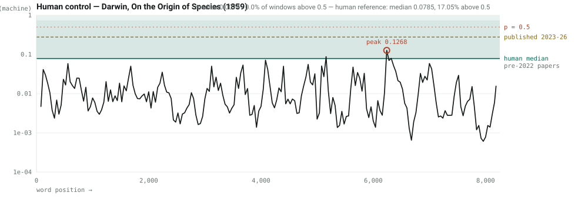
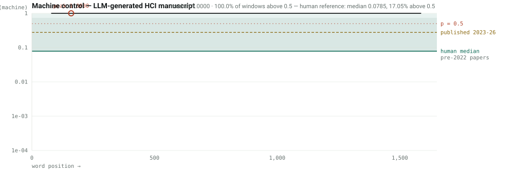
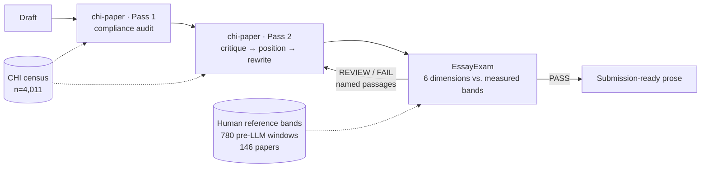

# ClaudeEssaySkill — measured writing guidance for ACM CHI, and a calibrated prose verifier

**English** | [中文](README.zh-CN.md)

> Two Claude Code skills that work as a generator/verifier pair for academic manuscripts.
> Everything they assert about "what a normal paper looks like" is measured against a
> **census of 4,011 ACM CHI papers (2024–2026)** and a reference corpus of human-written
> prose — not remembered, not inferred from a model's priors.
>
> The skill source is in a **private repository**; access is by request. This repository is the
> public record of what was built, how it was calibrated, and how well it currently performs.

---

## The problem this was built for

Writing advice for a top-tier venue is mostly folklore. "Keep the abstract around 250 words."
"A CHI paper runs about 10,000 words." "You need 60 references." These circulate, they sound
authoritative, and almost nobody has checked them against the actual proceedings.

For a first-time submitter with no CHI-published co-author, that is a real problem: there is no
intuition to fall back on, and no way to tell a reliable rule from a confident guess. So I stopped
taking the numbers on faith and measured them.

The result changed the advice. Two examples, both of which had been wrong in my own drafts:

| Folklore | Measured | Consequence of believing the folklore |
|---|---|---|
| "Abstract ≈ 150–250 words" | **150 words maximum** — stated on CHI's Papers page; census median **149**, 72.5% land in 140–160 | An abstract well over the cap, rejected by the submission form, discovered at the deadline |
| "CHI papers run ~11,300 words" | Official counted band is **5,000–8,000** (avg 7,000–8,000). The 11,300 figure was **raw text before the references heading** — different units | Padding an 8,600-word draft toward the 12,000-word desk-reject threshold |

The second one is the more instructive failure. The number was not invented; it was correctly
measured and then quoted in the wrong units, ~100 lines away from the compliance file that had the
right answer. Precision without unit discipline is just a confident error.

## The second problem: detector scores that mean nothing

Every AI-text detector returns a number in [0,1]. None of them tell you what it means. "This
paragraph scored 0.31" is not a probability that you cheated, not a percentage of your text, and not
comparable across tools.

So the verifier does not report raw scores. It reports them **against a measured reference band**:
the same detector, the same window size, run over papers whose arXiv v1 predates ChatGPT's public
release — prose that *cannot* contain generated text.

That measurement produced the single most important number in this project:

> **17.1% of windows from definitively human-written academic papers score above 0.5.**
> 4.5% score above 0.9.

That is the detector's false-positive rate on the exact task people use it for. It means no single
passage score supports any conclusion, and it means every product that shows you a percentage is
showing you something it cannot justify.

## What the instrument sees

Two controls, run through the identical pipeline. Log scale, because a clean manuscript sits in the
thousandths and a linear axis flattens everything to zero. The green band is where pre-2022
human-written papers fall.

**Human control** — Darwin, *On the Origin of Species* (1859), public domain, written 163 years
before any language model existed:

**Machine control** — an HCI manuscript generated for this purpose, so its provenance is certain:

The separation is total, and it is not carried by the detector alone. All six dimensions fire
independently on the machine control, which is what construct validity looks like:

| | verdict | median window | windows > 0.5 | fingerprint | sentence CV | defensive/1k | vague/1k |
|---|---|---:|---:|---:|---:|---:|---:|
| Darwin 1859 (human) | PASS 9/9 | 0.0074 | 0% | 0.7% | 0.619 | 0.0 | 7.27 |
| LLM-generated | **FAIL 7/9** | 1.0000 | 100% | 16.0% | 0.419 | 6.06 | 19.38 |
| *human reference band* | — | *0.0785* | *17.1%* | *median 0.6%* | *median 0.56* | *0.24* | *3.65* |

Note the honest detail: Darwin's peak window reaches 0.13, and his vague-term rate (7.27/1k) sits
above the modern median. The instrument does not pretend that human writing is clean — it reports
where real human prose actually falls, which is the only way its thresholds mean anything.

## The two skills

**`chi-paper`** — the generator. Venue rules verified per cycle, section-by-section structure,
contribution framing, genre routing (empirical / design-arts / general), figures, citations,
positioning, a three-reader mock review with CHI's real A–ARR–RR–RRX–X recommendations, and the
revise-and-resubmit cycle. Plus three stdlib-only tools: a `.docx` compliance auditor, a
corpus-calibrated stylometric fingerprint, and run-boundary-safe `.docx` surgery.

**`EssayExam`** — the verifier. Six dimensions over a draft: sliding-window machine-likeness with the
full probability curve, stylometric fingerprint, defensive/hedged writing, redundancy and
near-duplicate sentences, semantic precision, and logical flow. Returns a pass/review/fail gate where
every check names its source, plus the self-contained HTML curve shown above. Runs entirely locally —
no text leaves the machine.

They compose: `chi-paper` decides what the paper should say and rewrites it; `EssayExam` measures
whether the rewrite actually improved, and hands failing passages back.

## How it was built and tested

The skills were hardened with a GAN-shaped loop: a white-box **adversary** writes realistic user
requests designed to break the skill, a blind **generator** answers them using only the skill, and two
independent blind **verifiers** score the answers against the census on a fixed five-dimension rubric.
Failures become patches; the next round attacks the patches.

| Round | Scenarios | Mean | Inter-rater gap | Result |
|---|---:|---:|---:|---|
| 1 — baseline | 12 | **85.6** | 2.1 | 1 FAIL (39.0), 2 WEAK |
| 1 — re-test after patching | 6 | **89.1** | — | **+19.4 mean**; the FAIL rose 39.0 → 80.0 and 92.7 |
| 2 — harder set | 12 | **92.6** | 2.2 | 12/12 PASS |

Round 1's findings drove the abstract fix, the word-unit fix, a silent parser bug that inflated
counted word totals by ~1,000 words on a 38-reference paper, missing title guidance, and missing
statistical-procedure guidance. Re-testing those same scenarios against the patched skill is the
check that matters: the patches generalised rather than memorising the cases.

A third and harder round was then generated, aimed squarely at the newest material — the
just-written statistics section, the handoff between the two skills, and genre-routing edges. It is
**not yet scored**, and it has already produced two confirmed defects, both now fixed:

- The new statistics section quoted base rates (3% / 9.5% / 5.5%) that **contradicted another
  section of the same file** (4% / 11% / 7%). Both were correct for their own denominator and neither
  said so — the same units failure as the word-count bug, committed while writing the fix for it.
- `EssayExam`'s fast path skips the three detector checks, and the gate counted only *failing*
  checks — so a document that would fail on machine-likeness alone could report **PASS** with the
  headline dimension silently not run. There is now a distinct `INCOMPLETE` verdict.

Both were found by the adversary, not by review. That is the argument for keeping the loop running.

The protocol, including where the GAN analogy breaks and the anti-degeneracy rules, is in
[`docs/adversarial-protocol.md`](docs/adversarial-protocol.md). The full census audit is in
[`docs/audit-skill-vs-census.md`](docs/audit-skill-vs-census.md).

## What is published here

| | |
|---|---|
| [`data/chi_census_2024_2026.json`](data/chi_census_2024_2026.json) | Measurements over all 4,011 CHI main-conference papers 2024–2026: abstract lengths, reference counts, title conventions, author counts, subfield composition, per-year trends |
| [`data/calibration_bands.json`](data/calibration_bands.json) | The human reference distributions — percentiles, means, share-over-threshold, for both strata |
| [`data/lexical_bands.json`](data/lexical_bands.json) | Per-1,000-word rates for the four deterministic prose dimensions, with reliability annotations |
| [`gallery/`](gallery/) | Interactive HTML reports for both control documents |
| [`reports/`](reports/) | Full text reports, and the machine-control source document |
| [`docs/`](docs/) | Census audit, adversarial protocol |

**What is deliberately not published:** the source PDFs and full texts the bands were computed from
(4 GB of copyrighted papers), and any output from unpublished manuscripts under review. The published
data are *measurements*, not the works measured. Every band can be rebuilt from scratch with the
harvest and calibration scripts in the core repository.

## Access

The skill source lives in a private repository. If you want to use it, open an issue here saying what
you would use it for, and I will add you as a collaborator.

A note on why it is arranged this way: **GitHub has no repository mode that shows content publicly
while gating clones.** Public means anyone can `git clone`; private means nobody can without an
invitation. There is no middle setting, because Git's protocol has to serve every object to render
any file. A public repo with a restrictive licence is a *legal* gate, not a technical one. So the
split is: this repository public, the source private, access by invitation.

## Honest limits

- **This does not detect AI authorship.** No detector can. The 17.1% false-positive floor is measured
  above. ACM and CHI run no detector step; their requirement is **disclosure**.
- **There is no "AI percentage" of a document.** The number does not exist. Any tool reporting one is
  reporting something it cannot justify.
- **A passing gate certifies prose, not contribution.** Reviewers decide on the contribution, and a
  fluent paper with a thin contribution loses to a rough paper with a strong one.
- **The bands are open-access-skewed.** They come from arXiv versions of published papers, which
  over-represent authors who post preprints.
- **Calibrated on CHI-family and HCI prose.** The thresholds should transfer to any venue in a
  comparable academic register, but that transfer has not been tested outside HCI. Venue *rules* —
  length, format, structure — do not transfer at all.
- **The strata gap is a signal of unknown composition.** Papers published 2023–26 score far above
  pre-2022 ones (median 0.277 vs 0.079). That is consistent with widespread LLM assistance in current
  academic writing, but it is confounded with sample differences between the two collections, and it
  is not a measured rate of AI use.

## Licence

Source code and skill content: all rights reserved, access by invitation (see above).
The derived measurements in `data/` are released under [CC BY 4.0](LICENSE-DATA) — cite this
repository if you use them.
